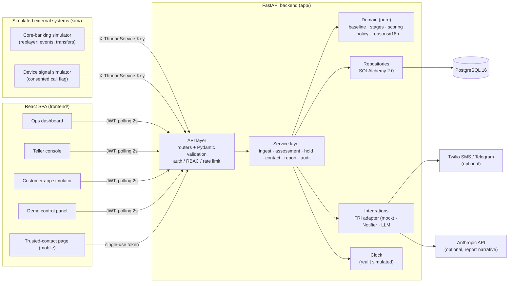
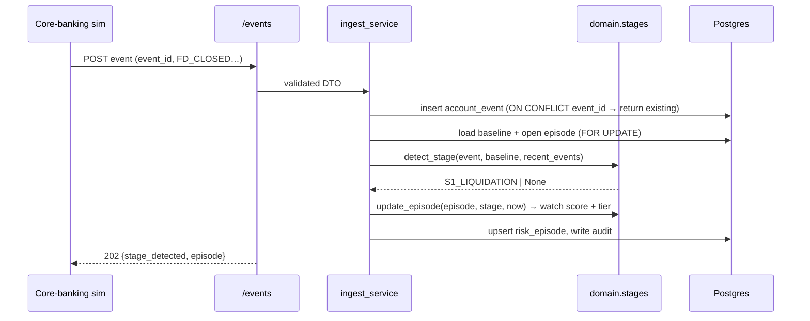
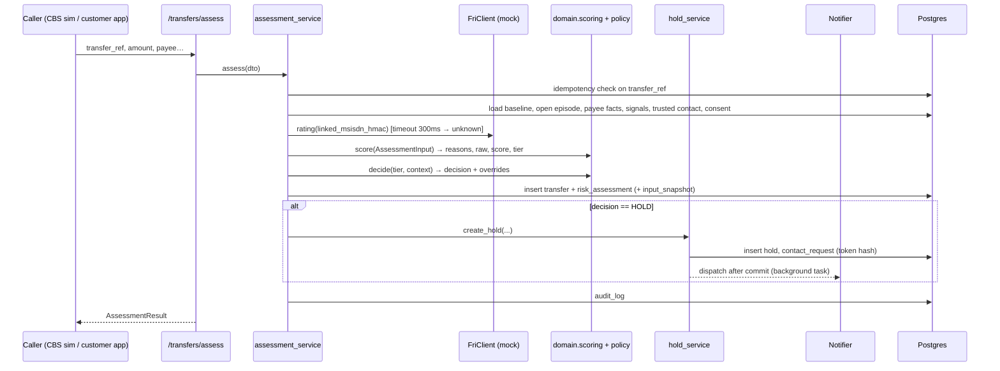
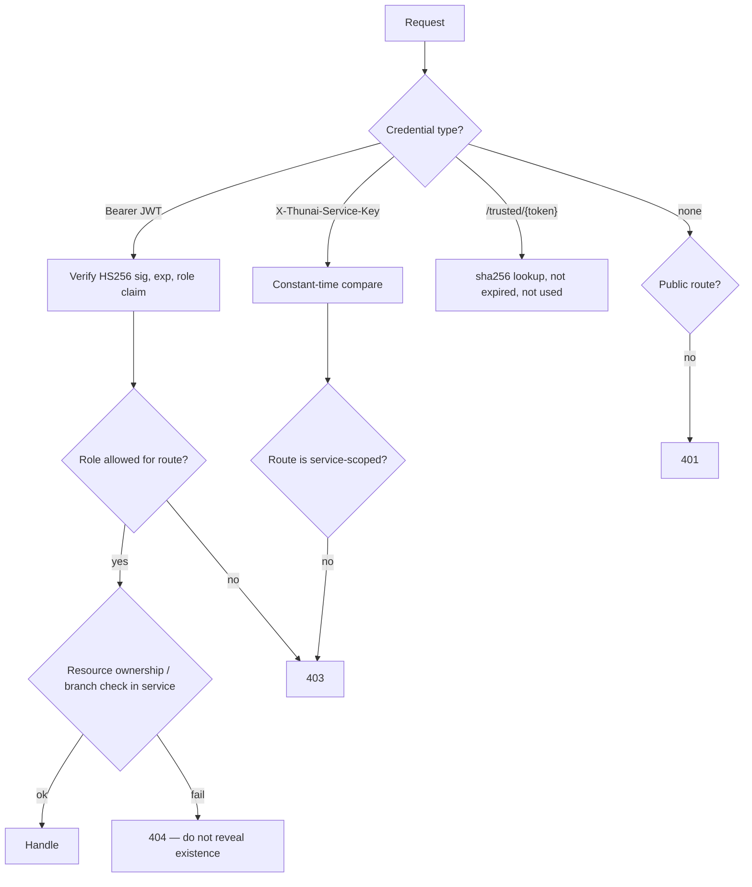

# Thunai — Architecture

## 1. Summary

Thunai is a **modular monolith**. It has one FastAPI backend process, one PostgreSQL database and one React single-page app. A separate **simulator** process plays the role of the bank's core banking system and the customer's phone, and it talks to the backend **only over HTTP**, as a real integration would. There are no microservices, message brokers or model servers. The requirements (50 customers, one branch, a 24–48 h build) don't justify them ([DECISIONS.md](DECISIONS.md) ADR-001).

## 2. High-level diagram



## 3. Component responsibilities

| Component | Path | Responsibility | Must not |
|---|---|---|---|
| API layer | `backend/app/api/v1/` | HTTP routing, Pydantic validation, auth dependencies, mapping domain errors to the error envelope | Contain business rules or SQL |
| Schemas | `backend/app/schemas/` | Request/response DTOs. This is the source of OpenAPI | Import ORM models |
| Services | `backend/app/services/` | Orchestration and transactions: load data, call the domain, persist, write audit, dispatch notifications | Format HTTP responses |
| Domain | `backend/app/domain/` | **Pure functions.** Baseline stats, stage detection, episode updates, scoring, policy, reason text | Do any I/O, read the clock directly, import SQLAlchemy/FastAPI/httpx, or read `scenario_label` |
| Repositories | `backend/app/repositories/` | All queries. Return ORM objects or simple dataclasses | Contain business rules |
| Models | `backend/app/models/` | SQLAlchemy ORM mapped classes | — |
| Integrations | `backend/app/integrations/` | `FriClient` (Protocol, with a `MockFriClient`), `Notifier` (Console/Twilio/Telegram), `NarrativeDrafter` (Template/Claude) | Be called from the domain |
| Core | `backend/app/core/` | Settings, logging, errors, security (JWT, hashing, crypto), `Clock`, rate limiter | — |
| Simulator | `backend/sim/` | Synthetic generator, scenario YAML, replayer (HTTP client), evaluator, seeder | Import `app.domain` or `app.services`. It **may** import `app.models` only in `seed.py` (direct DB seeding is faster) and `app.core.settings` |
| Frontend | `frontend/src/` | Five surfaces, a typed API client generated from OpenAPI, i18n | Re-implement scoring or tier logic. It displays what the API returns |

The boundaries are enforced by `tests/test_architecture.py`, which inspects imports with `ast`. It fails if `app/domain` imports I/O libraries, or if `sim/` imports domain or service modules.

## 4. Key flows

### 4.1 Event ingestion and the multi-day stage tracker



### 4.2 Transfer assessment and hold



Notifications are dispatched **after the transaction commits**, using FastAPI `BackgroundTasks`. A notifier failure therefore never rolls back a hold. Delivery status is updated on the `contact_requests` row. If the process restarts mid-send, the hold remains, and staff can trigger `resend-contact`. This is acceptable for the MVP. Production would use an outbox table and a worker ([ROADMAP.md](ROADMAP.md) post-hackathon).

### 4.3 Trusted-contact release

```mermaid
sequenceDiagram
  participant TC as Trusted contact phone
  participant WEB as /trusted/:token page
  participant API as /trusted/{token}
  participant CS as contact_service
  participant DB as Postgres
  TC->>WEB: open link from SMS/Telegram
  WEB->>API: GET /trusted/{token}
  API->>CS: sha256(token) lookup, check not expired/used
  CS-->>WEB: minimal info (first name, amount)
  TC->>WEB: tap "I spoke to her — it's genuine"
  WEB->>API: POST response
  API->>CS: consume token (UPDATE … WHERE responded_at IS NULL) 
  CS->>DB: HIGH → hold RELEASED, transfer EXECUTED, episode CLOSED_BENIGN; VERY_HIGH → record only
  CS->>DB: audit_log
```

The consume step is a single conditional `UPDATE`, so a double-tap or replay is safe.

### 4.4 Branch (teller) flow

1. The simulator posts a branch transfer (`channel=BRANCH`), and the assessment HOLDs it.
2. The teller console polls `/teller/queue` and shows the alert with reasons.
3. The teller taps checklist items. The backend stores a `TELLER_CHECKLIST` signal and re-scores, which can only escalate.
4. The teller opens the Tamil/English script, then generates the report draft.
5. The officer reviews and releases or cancels in the ops dashboard.

### 4.5 Authentication and authorisation



The role checks are FastAPI dependencies: `require_roles("OFFICER")`. Ownership checks (a customer's own transfer, or a staff member's branch) live in the services, so they cannot be skipped by a new route.

### 4.6 AI inference flow

There is no model server. Scoring is an in-process function call (§4.2). The LLM narrative is a separate on-demand path: officer click → `report_service` → pseudonymise → `ClaudeNarrativeDrafter` (timeout 10 s) → validator → re-identify, with a template fallback on any failure ([AI_DESIGN.md](AI_DESIGN.md) §12).

### 4.7 Simulated time

- `Clock` is a Protocol with `now()`. `RealClock` is used in production. `SimClock` (demo mode) computes `sim_now + (wall time since it was set) × speed`, so the demo clock keeps moving between replayer steps. The replayer re-anchors it at each step through `POST /demo/clock` (speed 0 freezes it). The state lives in memory in the single API process and is persisted to `sim_state`, so it survives a restart.
- Engine logic (payee age, windows, cooling-off) uses the timestamps on events and transfers plus `Clock.now()`. **Wall clock is used only for** token expiry, rate limits and the `received_at` / `created_at` columns.
- Cooling-off expiry is evaluated lazily. Reading holds checks `cooling_off_until < clock.now()` and moves AWAITING_CONTACT to AWAITING_OFFICER. No scheduler is needed in the MVP.

## 5. Failure handling

| Failure | Detection | Behaviour |
|---|---|---|
| DB unavailable | `/readyz` and SQLAlchemy errors | 503 `DEPENDENCY_UNAVAILABLE`. Assessment returns 503 and **never allows by default** |
| FRI adapter slow or failing | 300 ms timeout | 0 points, plus an info reason `FRI_UNAVAILABLE` |
| Notifier failure (Twilio/Telegram) | Provider exception | `delivery_status=FAILED`. Automatic fallback to the console notifier. The UI shows "SMS failed — use resend or call the contact" |
| LLM failure | Timeout, error, refusal or validator rejection | Template narrative and an `X-Thunai-LLM-Fallback` header |
| Invalid scoring config | Startup validation | The process refuses to start. `/readyz` is never green |
| Duplicate submissions | Unique keys | Idempotent replay (API_SPEC §2.3) |
| Concurrent updates to an episode | `SELECT … FOR UPDATE` on the open episode row | Events for one customer are serialised |
| Frontend loses connection | Query error state | A "Reconnecting…" banner. Polling retries with backoff (TanStack Query) |

## 6. Caching and background processing

- **No cache layer.** Each request is a handful of indexed queries at this scale.
- The scoring config is loaded once at startup and kept in memory.
- **Background work:** only notification dispatch (FastAPI `BackgroundTasks`) and the demo scenario run, an asyncio task in the API process started by `/demo/scenarios/{id}/run`. The task calls the API over HTTP via `httpx`, so the HTTP boundary stays intact. The CLI replayer (`python -m sim.replay`) can be used instead.

## 7. Scalability (post-hackathon thinking; not built)

| Concern | At hackathon scale | Path at bank scale |
|---|---|---|
| Event volume | Tens of events per second | Partition by `customer_id`. Ingest from a CBS stream (e.g., Kafka) into the same `ingest_service`. Horizontal API replicas |
| Episode serialisation | Row lock | Keep a per-customer partitioned consumer, so there are no cross-customer locks |
| Baselines | Recomputed on demand | A nightly batch (Spark/SQL) plus incremental updates |
| Rate limiting | In-process | Redis or the API gateway |
| Notifications | BackgroundTasks | An outbox table and a worker with retries |
| Audit | Postgres table | WORM storage or SIEM export |

The domain layer is pure, so these changes don't touch the scoring code.

## 8. Major design decisions (details in [DECISIONS.md](DECISIONS.md))

| Decision | Chosen | Rejected alternatives |
|---|---|---|
| Overall shape | Modular monolith | Microservices; serverless functions |
| Scoring | Explainable additive model plus rules | A gradient-boosted model trained on synthetic data; a black-box anomaly detector |
| Live updates | Polling every 2 s | SSE/WebSocket (Could Have, FR-25) |
| Datastore | PostgreSQL | SQLite (weak concurrency for the parallel simulator and UI); MongoDB (weaker constraints) |
| Simulator coupling | HTTP only | Calling services directly (would hide integration bugs and flatter the demo) |
| Time | Injectable Clock | Wall clock (would make a multi-day demo impossible) |
