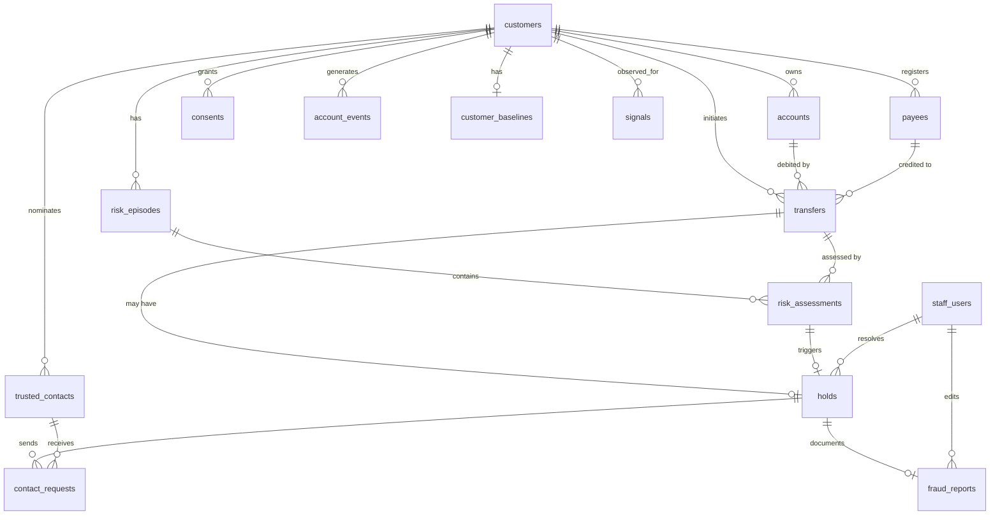
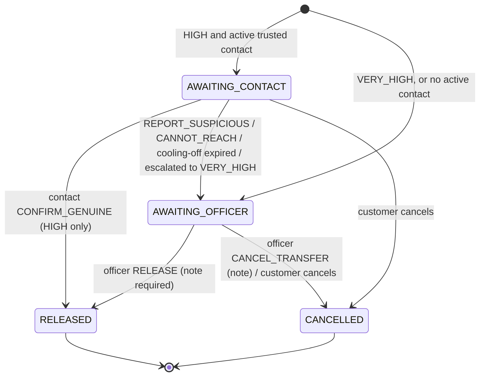

# Thunai — Database Schema

- **Engine:** PostgreSQL 16
- **ORM:** SQLAlchemy 2.0, typed `Mapped[]` models in `backend/app/models/`
- **Migrations:** Alembic, in `backend/migrations/`

The schema serves the user flows in [docs/USER_FLOWS.md](docs/USER_FLOWS.md) and the API in [API_SPEC.md](API_SPEC.md). Field names are the source of truth for the Pydantic schemas.

## 1. Conventions

| Rule | Detail |
|---|---|
| Primary keys | `id UUID` (generated in the app with `uuid4`). The exception is `audit_log.id BIGSERIAL`, which gives ordering |
| Money | `BIGINT` **paise**, column suffix `_paise`. Floats are never used for money |
| Time | `TIMESTAMPTZ`, stored in UTC and displayed in IST (`Asia/Kolkata`). Event and assessment times come from the **Clock**, which is simulated in demo mode. `received_at` / `created_at` are wall-clock |
| Enums | `TEXT` with a `CHECK` constraint (no native PG enums), so migrations stay easy. The Python `StrEnum` is the source of truth |
| Names | `snake_case`. Tables are plural. Foreign keys are `<entity>_id` |
| Flexible payloads | `JSONB`, used only for event payloads, reason lists, evidence and report drafts |
| Soft delete | Not used. Lifecycle is modelled with `status` columns. Audit data is append-only |
| Personal data | Minimal (see §6). Phone numbers are encrypted or HMAC-hashed. No dates of birth, addresses, ID numbers or call content |

## 2. ER diagram



`audit_log`, `fri_mock_ratings` and `sim_state` stand alone. Audit rows reference entities by `(entity_type, entity_id)`.

## 3. Tables

### 3.1 `staff_users`
| Column | Type | Constraints |
|---|---|---|
| id | UUID | PK |
| username | TEXT | UNIQUE, NOT NULL, 3–32 chars `[a-z0-9_.]` |
| password_hash | TEXT | NOT NULL (argon2id) |
| role | TEXT | NOT NULL, CHECK IN (`TELLER`,`OFFICER`,`ADMIN`) |
| display_name | TEXT | NOT NULL |
| branch_code | TEXT | NOT NULL |
| is_active | BOOLEAN | NOT NULL DEFAULT true |
| created_at | TIMESTAMPTZ | NOT NULL DEFAULT now() |

### 3.2 `customers`
| Column | Type | Constraints |
|---|---|---|
| id | UUID | PK |
| external_ref | TEXT | UNIQUE, NOT NULL (e.g., `CUST-0007`) |
| display_name | TEXT | NOT NULL (fictional) |
| preferred_language | TEXT | NOT NULL DEFAULT `en`, CHECK IN (`en`,`ta`) |
| branch_code | TEXT | NOT NULL |
| login_username | TEXT | UNIQUE NULL (demo customer-app login) |
| login_password_hash | TEXT | NULL |
| is_synthetic | BOOLEAN | NOT NULL DEFAULT true |
| created_at | TIMESTAMPTZ | NOT NULL |

There is deliberately **no age, gender, address or ID number** ([AI_DESIGN.md](AI_DESIGN.md), [SECURITY.md](SECURITY.md) §11). Narrative facts such as "72-year-old" live only in scenario metadata (`sim/scenarios/*.yaml`) for storytelling.

### 3.3 `accounts`
| Column | Type | Constraints |
|---|---|---|
| id | UUID | PK |
| customer_id | UUID | FK → customers.id, NOT NULL, INDEX |
| account_type | TEXT | CHECK IN (`SAVINGS`,`CURRENT`,`FD`,`RD`) |
| masked_number | TEXT | NOT NULL (`XXXXXX4821`) |
| balance_paise | BIGINT | NOT NULL, CHECK ≥ 0 |
| opened_at | TIMESTAMPTZ | NOT NULL |
| maturity_date | DATE | NULL. Required when `account_type IN ('FD','RD')` (CHECK) |
| status | TEXT | CHECK IN (`ACTIVE`,`CLOSED`) |

### 3.4 `payees`
| Column | Type | Constraints |
|---|---|---|
| id | UUID | PK |
| customer_id | UUID | FK, NOT NULL |
| payee_ref | TEXT | NOT NULL. UNIQUE (customer_id, payee_ref) |
| display_name | TEXT | NOT NULL |
| bank_name | TEXT | NOT NULL |
| ifsc | TEXT | NOT NULL, CHECK `^[A-Z]{4}0[A-Z0-9]{6}$` |
| masked_account | TEXT | NOT NULL |
| linked_msisdn_hmac | TEXT | NULL (HMAC-SHA256 of an E.164 number with `THUNAI_HMAC_KEY`). See A-03 |
| linked_msisdn_last4 | TEXT | NULL |
| added_at | TIMESTAMPTZ | NOT NULL |
| added_channel | TEXT | CHECK IN (`APP`,`BRANCH`,`NETBANKING`) |

Index: `(customer_id, added_at DESC)`.

### 3.5 `trusted_contacts`
| Column | Type | Constraints |
|---|---|---|
| id | UUID | PK |
| customer_id | UUID | FK, NOT NULL |
| display_name | TEXT | NOT NULL |
| relationship | TEXT | NOT NULL (free text, ≤ 40 chars) |
| phone_ciphertext | TEXT | NOT NULL (Fernet, key `THUNAI_PII_ENCRYPTION_KEY`) |
| phone_last4 | TEXT | NOT NULL |
| telegram_chat_id_ciphertext | TEXT | NULL (demo Telegram channel) |
| preferred_language | TEXT | CHECK IN (`en`,`ta`) |
| registered_at | TIMESTAMPTZ | NOT NULL |
| effective_from | TIMESTAMPTZ | NOT NULL (= registered_at + `THUNAI_TRUSTED_CONTACT_ACTIVATION_HOURS`) |
| status | TEXT | CHECK IN (`PENDING_ACTIVATION`,`ACTIVE`,`REVOKED`) |

There is a partial UNIQUE index on `(customer_id) WHERE status <> 'REVOKED'`: one contact per customer in the MVP. A contact is "active" at time *t* when `status <> 'REVOKED' AND effective_from <= t`. The status column is refreshed lazily.

### 3.6 `consents`
| Column | Type | Constraints |
|---|---|---|
| id | UUID | PK |
| customer_id | UUID | FK, NOT NULL |
| consent_type | TEXT | CHECK IN (`CALL_SIGNAL`,`TRUSTED_CONTACT_SHARING`) |
| granted | BOOLEAN | NOT NULL |
| text_version | TEXT | NOT NULL (e.g., `call_signal_v1`) |
| recorded_at | TIMESTAMPTZ | NOT NULL |

The latest row per `(customer_id, consent_type)` wins. Index on `(customer_id, consent_type, recorded_at DESC)`. Rows are append-only, so the consent history is kept.

### 3.7 `account_events`
| Column | Type | Constraints |
|---|---|---|
| id | UUID | PK |
| event_id | TEXT | UNIQUE, NOT NULL (idempotency key from the source system) |
| customer_id | UUID | FK, NOT NULL |
| account_id | UUID | FK NULL |
| event_type | TEXT | CHECK IN (`FD_CLOSED`,`INTERNAL_TRANSFER_IN`,`PAYEE_ADDED`,`TRUSTED_CONTACT_CHANGED`,`ROUTINE_DEBIT`,`ROUTINE_CREDIT`) |
| amount_paise | BIGINT | NULL, CHECK ≥ 0 |
| occurred_at | TIMESTAMPTZ | NOT NULL (simulated clock) |
| payload | JSONB | NOT NULL DEFAULT '{}' (validated per type by Pydantic) |
| stage | TEXT | NULL. CHECK IN (`S1_LIQUIDATION`,`S2_POOLING`,`S3_NEW_PAYEE`). Set by the stage tracker |
| received_at | TIMESTAMPTZ | NOT NULL DEFAULT now() |

Index: `(customer_id, occurred_at DESC)`.

### 3.8 `transfers`
| Column | Type | Constraints |
|---|---|---|
| id | UUID | PK |
| transfer_ref | TEXT | UNIQUE, NOT NULL (idempotency key) |
| customer_id | UUID | FK, NOT NULL |
| from_account_id | UUID | FK NOT NULL |
| payee_id | UUID | FK NOT NULL |
| amount_paise | BIGINT | NOT NULL, CHECK > 0 |
| rail | TEXT | CHECK IN (`RTGS`,`NEFT`,`IMPS`,`UPI`) |
| channel | TEXT | CHECK IN (`APP`,`BRANCH`,`NETBANKING`) |
| status | TEXT | CHECK IN (`PENDING`,`WARNED`,`HELD`,`EXECUTED`,`CANCELLED`) |
| initiated_at | TIMESTAMPTZ | NOT NULL |
| decided_at | TIMESTAMPTZ | NULL |
| executed_at | TIMESTAMPTZ | NULL |
| cancelled_reason | TEXT | NULL, CHECK IN (`CUSTOMER_CANCELLED`,`OFFICER_CANCELLED`,`CONTACT_REPORTED_SCAM_OFFICER_CONFIRMED`) |
| scenario_label | TEXT | NULL. Evaluation only, written by the simulator through a demo-only field. **Never read by the engine** (enforced by test) |

Indexes: `(customer_id, initiated_at DESC)`, `(status)`.

Allowed status transitions (enforced in `hold_service`):
`PENDING → EXECUTED | WARNED | HELD`
`WARNED → EXECUTED | CANCELLED`
`HELD → EXECUTED | CANCELLED`

### 3.9 `customer_baselines`
| Column | Type | Constraints |
|---|---|---|
| customer_id | UUID | PK, FK |
| computed_at | TIMESTAMPTZ | NOT NULL |
| history_days | INTEGER | NOT NULL |
| median_outbound_paise | BIGINT | NOT NULL |
| p95_outbound_paise | BIGINT | NOT NULL |
| qualifying_transfer_count | INTEGER | NOT NULL |
| premature_fd_closures_365d | INTEGER | NOT NULL |
| confidence | TEXT | CHECK IN (`OK`,`LOW`) |
| algorithm_version | TEXT | NOT NULL (`baseline_v1`) |

### 3.10 `risk_episodes`
| Column | Type | Constraints |
|---|---|---|
| id | UUID | PK |
| customer_id | UUID | FK, NOT NULL |
| status | TEXT | CHECK IN (`OPEN`,`EXPIRED`,`CLOSED_BENIGN`,`CLOSED_CONFIRMED_RISK`) |
| opened_at | TIMESTAMPTZ | NOT NULL |
| last_stage_at | TIMESTAMPTZ | NOT NULL |
| closed_at | TIMESTAMPTZ | NULL |
| stages | JSONB | NOT NULL. Ordered list `[{stage, event_id, occurred_at, amount_paise?, payee_id?}]` |
| watch_score | SMALLINT | NOT NULL DEFAULT 0, CHECK 0–100 |
| watch_tier | TEXT | CHECK IN (`LOW`,`MEDIUM`,`HIGH`,`VERY_HIGH`) |
| watch_history | JSONB | NOT NULL DEFAULT '[]'. `[{at, score, tier, trigger_event_id}]` for the chart |

There is a partial UNIQUE index on `(customer_id) WHERE status = 'OPEN'`: at most one open episode per customer.

### 3.11 `signals`
| Column | Type | Constraints |
|---|---|---|
| id | UUID | PK |
| customer_id | UUID | FK, NOT NULL |
| transfer_id | UUID | FK NULL (set for `TELLER_CHECKLIST`) |
| signal_type | TEXT | CHECK IN (`CALL_RISK`,`TELLER_CHECKLIST`) |
| value | JSONB | NOT NULL. CALL_RISK: `{call_type, caller_known, duration_min, ended_at?}`. TELLER_CHECKLIST: `{items: [...], customer_said?: string}` (`customer_said` is stored for the report and is **never scored**) |
| source | TEXT | CHECK IN (`DEVICE_SIMULATED`,`TELLER`) |
| observed_at | TIMESTAMPTZ | NOT NULL |
| recorded_by_staff_id | UUID | FK NULL |

Index: `(customer_id, signal_type, observed_at DESC)`. FRI is **not** stored here. It is looked up at assessment time and captured in the assessment's reason evidence.

### 3.12 `risk_assessments`
| Column | Type | Constraints |
|---|---|---|
| id | UUID | PK |
| transfer_id | UUID | FK, NOT NULL, INDEX |
| episode_id | UUID | FK NULL |
| trigger | TEXT | CHECK IN (`INITIAL`,`TELLER_CHECKLIST`,`SIGNAL_UPDATE`) |
| raw_score | SMALLINT | NOT NULL |
| score | SMALLINT | NOT NULL, CHECK 0–100 |
| tier | TEXT | CHECK IN (`LOW`,`MEDIUM`,`HIGH`,`VERY_HIGH`) |
| decision | TEXT | CHECK IN (`ALLOW`,`WARN`,`HOLD`) |
| reasons | JSONB | NOT NULL. `[{code, points, stage?, evidence, text_en, text_ta}]` |
| overrides_applied | JSONB | NOT NULL DEFAULT '[]' |
| input_snapshot | JSONB | NOT NULL. The full `AssessmentInput`, for reproducibility (NFR-09) |
| config_version | TEXT | NOT NULL |
| assessed_at | TIMESTAMPTZ | NOT NULL |

Rows are append-only. The latest row per transfer is current.

### 3.13 `holds`
| Column | Type | Constraints |
|---|---|---|
| id | UUID | PK |
| transfer_id | UUID | FK, UNIQUE, NOT NULL |
| assessment_id | UUID | FK NOT NULL (the assessment that created it) |
| tier | TEXT | CHECK IN (`HIGH`,`VERY_HIGH`). Can escalate HIGH → VERY_HIGH on re-score, and **never de-escalates** |
| status | TEXT | CHECK IN (`AWAITING_CONTACT`,`AWAITING_OFFICER`,`RELEASED`,`CANCELLED`) |
| contact_response | TEXT | NULL, CHECK IN (`CONFIRM_GENUINE`,`REPORT_SUSPICIOUS`,`CANNOT_REACH`) |
| created_at | TIMESTAMPTZ | NOT NULL |
| cooling_off_until | TIMESTAMPTZ | NOT NULL |
| resolved_at | TIMESTAMPTZ | NULL |
| resolved_by_type | TEXT | NULL, CHECK IN (`TRUSTED_CONTACT`,`OFFICER`,`CUSTOMER`) |
| resolved_by_staff_id | UUID | FK NULL |
| resolution_note | TEXT | NULL (≤ 1000 chars). Required when `resolved_by_type='OFFICER'` (CHECK) |

Index: `(status, created_at)`.

Hold state machine:



A VERY_HIGH hold still notifies the trusted contact, but it starts in `AWAITING_OFFICER`. The contact's response is recorded in `contact_response` and shown to the officer.

### 3.14 `contact_requests`
| Column | Type | Constraints |
|---|---|---|
| id | UUID | PK |
| hold_id | UUID | FK, NOT NULL, INDEX |
| trusted_contact_id | UUID | FK NOT NULL |
| token_hash | TEXT | UNIQUE, NOT NULL (SHA-256 of a 32-byte random token. The raw token exists only in the outgoing message) |
| channel | TEXT | CHECK IN (`CONSOLE`,`SMS`,`TELEGRAM`) |
| delivery_status | TEXT | CHECK IN (`QUEUED`,`SENT`,`FAILED`) |
| delivery_error | TEXT | NULL (provider error code only) |
| expires_at | TIMESTAMPTZ | NOT NULL (wall clock + `THUNAI_CONTACT_TOKEN_TTL_MINUTES`) |
| opened_at | TIMESTAMPTZ | NULL |
| responded_at | TIMESTAMPTZ | NULL |
| response | TEXT | NULL (same values as `holds.contact_response`) |
| created_at | TIMESTAMPTZ | NOT NULL |

A token is valid only when `responded_at IS NULL AND now() < expires_at`. Resending creates a new row, and earlier unresponded rows for the hold get `expires_at = now()`.

### 3.15 `fraud_reports`
| Column | Type | Constraints |
|---|---|---|
| id | UUID | PK |
| hold_id | UUID | FK, UNIQUE, NOT NULL |
| status | TEXT | CHECK IN (`DRAFT`,`READY`,`FILED_EXTERNALLY`) |
| structured_fields | JSONB | NOT NULL (see [API_SPEC.md](API_SPEC.md) §7) |
| customer_reported | JSONB | NOT NULL DEFAULT '{}' (teller-entered: caller claimed identity, scammer numbers the customer gave, platform) |
| narrative_text | TEXT | NOT NULL |
| narrative_source | TEXT | CHECK IN (`TEMPLATE`,`LLM`,`EDITED`) |
| acknowledgement_number | TEXT | NULL (from the 1930 or cybercrime.gov.in acknowledgement, entered manually) |
| created_by_staff_id | UUID | FK NOT NULL |
| updated_by_staff_id | UUID | FK NOT NULL |
| created_at / updated_at | TIMESTAMPTZ | NOT NULL |

### 3.16 `audit_log` (append-only)
| Column | Type | Constraints |
|---|---|---|
| id | BIGSERIAL | PK |
| occurred_at | TIMESTAMPTZ | NOT NULL DEFAULT now() |
| actor_type | TEXT | CHECK IN (`STAFF`,`CUSTOMER`,`TRUSTED_CONTACT`,`SERVICE`,`SYSTEM`) |
| actor_id | TEXT | NULL (staff/customer UUID, contact_request id, or `simulator`) |
| action | TEXT | NOT NULL (e.g., `ASSESSMENT_CREATED`, `HOLD_RELEASED`, `LOGIN_FAILED`) |
| entity_type | TEXT | NOT NULL |
| entity_id | TEXT | NOT NULL |
| request_id | TEXT | NULL |
| details | JSONB | NOT NULL DEFAULT '{}'. **Never** holds secrets, tokens or full phone numbers |

Index: `(entity_type, entity_id, occurred_at)`. The migration revokes `UPDATE` and `DELETE` on `audit_log` from the app role (production). In development the app role owns the table, and append-only is enforced in code and by test.

### 3.17 `fri_mock_ratings` (SIMULATED)
| Column | Type | Constraints |
|---|---|---|
| msisdn_hmac | TEXT | PK |
| rating | TEXT | CHECK IN (`MEDIUM`,`HIGH`,`VERY_HIGH`) |
| note | TEXT | NOT NULL DEFAULT 'SIMULATED — not real DoT data' |
| updated_at | TIMESTAMPTZ | NOT NULL |

### 3.18 `sim_state` (demo only, single row)
| Column | Type | Constraints |
|---|---|---|
| id | SMALLINT | PK, CHECK id = 1 |
| sim_now | TIMESTAMPTZ | NOT NULL (current simulated time) |
| speed | REAL | NOT NULL (simulated seconds per real second) |
| running_scenario | TEXT | NULL |
| updated_at | TIMESTAMPTZ | NOT NULL |

## 4. Migration strategy

1. Every schema change is an Alembic revision: `uv run alembic revision --autogenerate -m "<what>"`. **Review the generated file by hand.** Autogenerate misses CHECK constraints and partial indexes, so add those explicitly.
2. The initial revision `0001_initial` creates every table above. Seed data is **not** in migrations. It goes through `python -m sim.seed`.
3. Every migration needs a working `downgrade()` during the hackathon. Test it with `alembic downgrade -1 && alembic upgrade head` in CI (T-043).
4. Never edit an applied migration. Add a new one.
5. Production rule (post-hackathon): use expand → migrate → contract for destructive changes.

## 5. Data retention (proposed for production; the MVP uses synthetic data only)

| Data | Retention | Basis |
|---|---|---|
| Transfers, assessments, holds, reports, audit log | ≥ 5 years after the transaction (to be confirmed by bank compliance) | PMLA record-keeping and RBI fraud-reporting expectations. **Verify with counsel** |
| Call-risk signals | 90 days, then delete | Data minimisation. The flag is only useful briefly |
| Contact request tokens | Hash only. Row kept with the hold | Audit of who was asked and when |
| Trusted contact phone | Until revoked plus 30 days | DPDP purpose limitation |
| Consents | Life of the customer relationship plus 5 years | Proof of consent |
| `sim_state`, synthetic data | Reset at will | Demo only |

## 6. Access control (enforced in the service layer, see [SECURITY.md](SECURITY.md) §3)

| Table | TELLER | OFFICER | ADMIN | CUSTOMER | Trusted contact (token) | Service key |
|---|---|---|---|---|---|---|
| customers / accounts / payees | Read (own branch) | Read (own branch) | Read | Own only | — | Write (ingest) |
| account_events | — | Read | Read | — | — | Write |
| transfers / assessments | Read (own branch) | Read | Read | Own, status only | — | Write (assess) |
| signals | Write `TELLER_CHECKLIST` | Read | Read | — | — | Write `CALL_RISK` |
| holds | Read | Read and resolve | Read | Own status, and cancel | Respond (own request) | — |
| contact_requests | — | Read (no token) | Read | — | Own row only | — |
| fraud_reports | Create and edit | Create, edit, mark filed | Read | — | — | — |
| trusted_contacts | Read masked | Read masked | Read masked | Own, write | — | — |
| audit_log | — | Read | Read | — | — | — |
| sim_state, fri_mock_ratings | — | — | Write (demo) | — | — | — |

Branch scoping: in the MVP every seeded user and customer has `branch_code = "CHN001"`. The checks still exist so that multi-branch support is a data change, not a code change.

## 7. Example records (all fictional)

```json
// customers
{"id": "7b0e…", "external_ref": "CUST-0007", "display_name": "R. Kamala (fictional)",
 "preferred_language": "ta", "branch_code": "CHN001", "is_synthetic": true}

// payees
{"payee_ref": "PAY-0007-03", "display_name": "Verification Account", "bank_name": "Example Bank",
 "ifsc": "EXMP0001234", "masked_account": "XXXXXX4821", "linked_msisdn_last4": "0193",
 "added_at": "2026-10-03T09:12:00+05:30", "added_channel": "APP"}

// risk_assessments.reasons[0]
{"code": "NEW_PAYEE", "points": 20, "stage": "S3",
 "evidence": {"payee_age_minutes": 128, "payee_ref": "PAY-0007-03"},
 "text_en": "Payee was added 2 hours before this transfer.",
 "text_ta": "இந்த பரிமாற்றத்திற்கு 2 மணி நேரத்திற்கு முன்புதான் பெறுநர் சேர்க்கப்பட்டார்."}

// holds
{"tier": "VERY_HIGH", "status": "AWAITING_OFFICER", "contact_response": "REPORT_SUSPICIOUS",
 "cooling_off_until": "2026-10-03T15:20:00+05:30"}

// fri_mock_ratings
{"msisdn_hmac": "9f2c…", "rating": "HIGH", "note": "SIMULATED — not real DoT data"}
```
