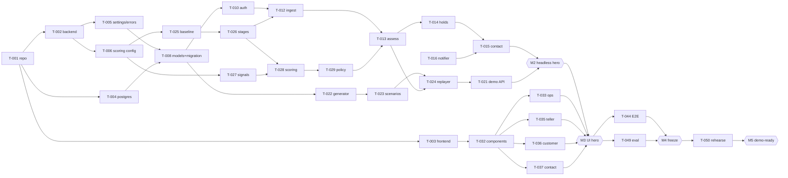

# Kaaval AI — Roadmap

> **Theme 1: Real-Time AI for Critical Decisions. Category: Citizen scam/fraud defense.** Deadline: 24–48 h hackathon, **exact time still to be filled in**. The **feature freeze at H+20 stands regardless.** If the event is 48 h, use §3.

| Kickoff (H+0) | Submission deadline | Judging / demo slot |
|---|---|---|
| `[FILL IN] IST` | `[FILL IN] IST` | `[FILL IN] IST` |

## 1. Milestones (24 h baseline)

| Milestone | Window | Outcome | Gate (details in [docs/MILESTONES.md](docs/MILESTONES.md)) |
|---|---|---|---|
| **M0 — Contracts frozen** | H+0 → H+2 | Repo, scaffolds, Postgres running. API, schema and scoring table agreed. Twilio/Telegram trial started | G0 |
| **M1 — Engine and core backend** | H+2 → H+8 | Domain golden tests pass. Ingest, assess, holds and contact backend done. Generator seeds 50 customers. Frontend shell and components exist | G1 |
| **M2 — Headless hero** | H+8 → H+12 | P1 and N1 run end to end via the replayer and API. The console notifier produces a working link | G2 |
| **M3 — UI hero** | H+12 → H+17 | Teller, Ops, Customer, Contact and Demo surfaces run the full demo on the real API. The real phone receives the link | G3 |
| **M4 — Hardened and frozen** | H+17 → H+20 | E2E, authorisation matrix, security checks, evaluation report, bug fixes. **Feature freeze at H+20** | G4 |
| **M5 — Demo-ready** | H+20 → H+24 | Three rehearsals, backup video, slides, submission | G5 |

Check-ins: **15 minutes at H+2, H+6, H+12, H+17 and H+20**. At each one, every workstream reports *done / next / blocked*, and the team decides whether to cut scope.

## 2. Recommended development order (critical path)

## 3. If the event is 48 h

| Window | Add (in this order; stop when time runs out) |
|---|---|
| H+20 → H+28 | T-041 real SMS/Telegram polish · T-051 consent and trusted-contact screens · T-031 LLM narrative · T-048 hosted deploy |
| H+28 → H+36 | Expand the scenario families' randomisation. FR-26 logistic-regression calibration experiment (report only, no change to the shipped weights without a team decision). Accessibility pass with Lighthouse |
| H+36 → H+40 | **Feature freeze.** Run the evaluation again. Fix bugs only |
| H+40 → H+48 | Rehearsals ×5, video, slides, Q&A drill, submission |

The freeze rule is the same in both cases: **no new features after the freeze.** Only bug fixes, each with a test.

## 4. Post-hackathon roadmap (indicative; not commitments)

| Phase | Focus | Exit criterion |
|---|---|---|
| R1 (weeks 1–4) | Code clean-up, outbox for notifications, score decay and cumulative amounts, more scenario families from coded public cases ([docs/DATA_SOURCES.md](docs/DATA_SOURCES.md) §3) | Evaluation report v2. Coded case library of 20+ cases |
| R2 (months 2–3) | User research: 5+ seniors, 5+ adult children, 2+ branch staff (validating A-05 and A-06). Legal review of the hold authority (A-02) against the published RBI SOP | Research synthesis. Legal memo |
| R3 (months 3–6) | Sandbox pilot with one bank or cooperative bank: shadow mode (score but don't act) on real anonymised flows | Measured false-hold and interception rates on real data |
| R4 | Production integrations (DIP/FRI, device SDK, bank SSO) and a learned model behind the reason contract | Bank security and compliance sign-off |
